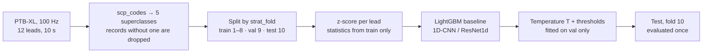
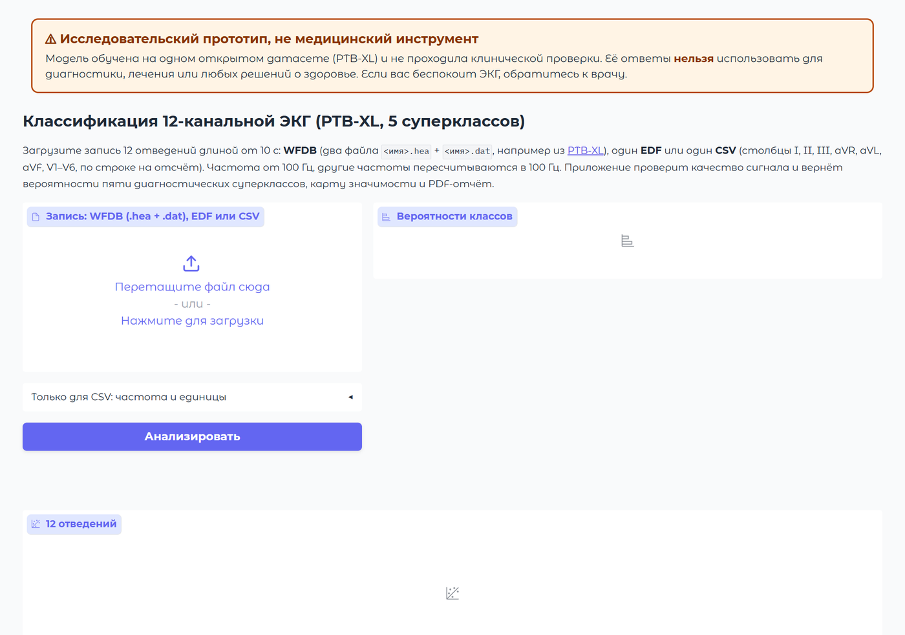
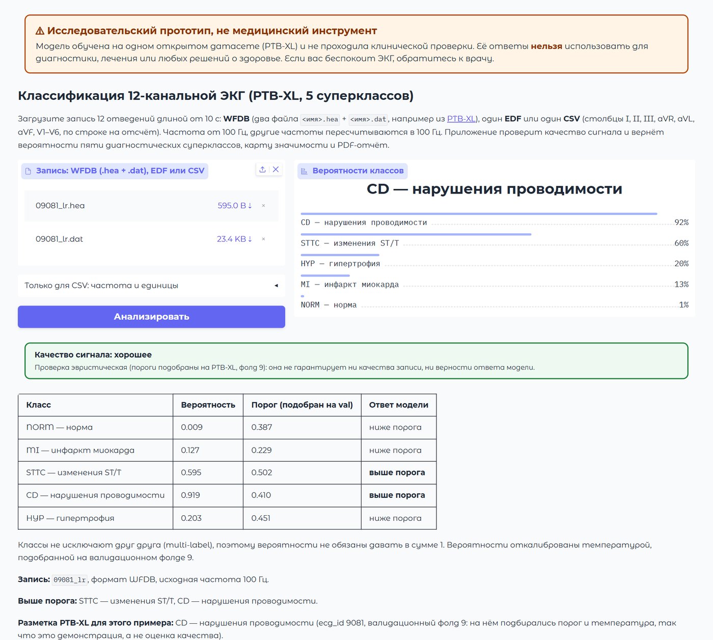
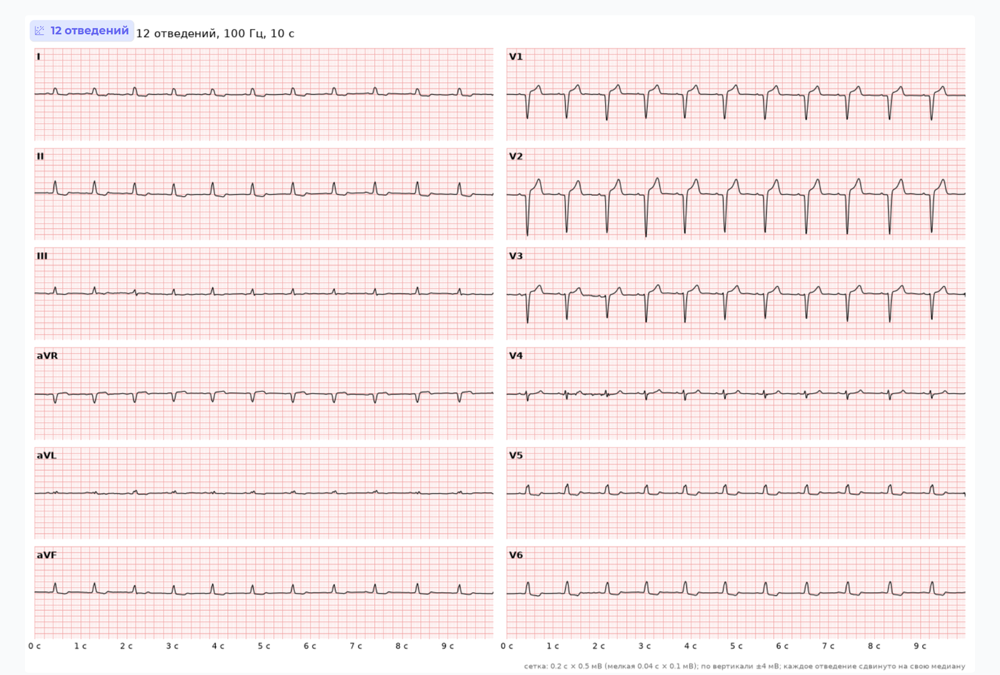
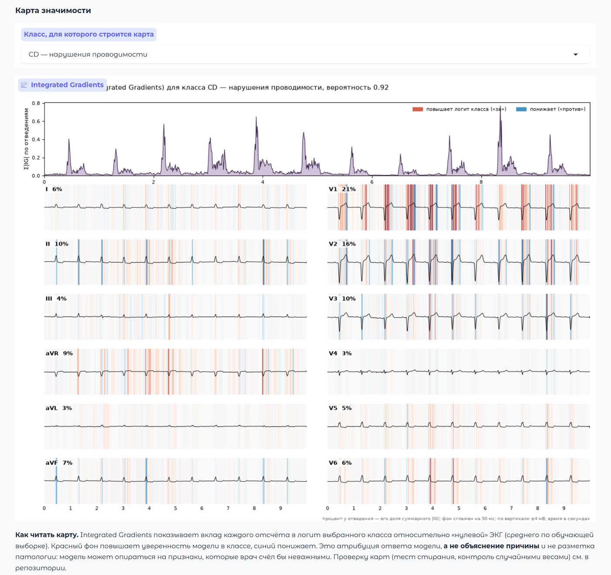
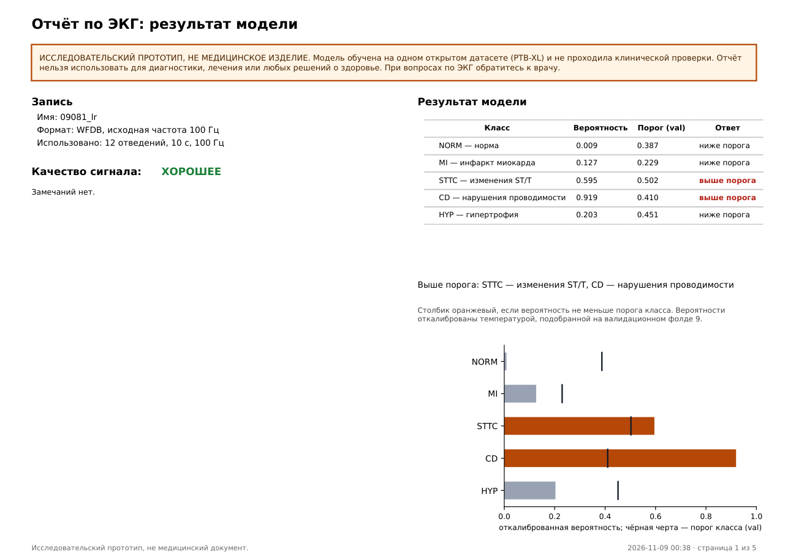
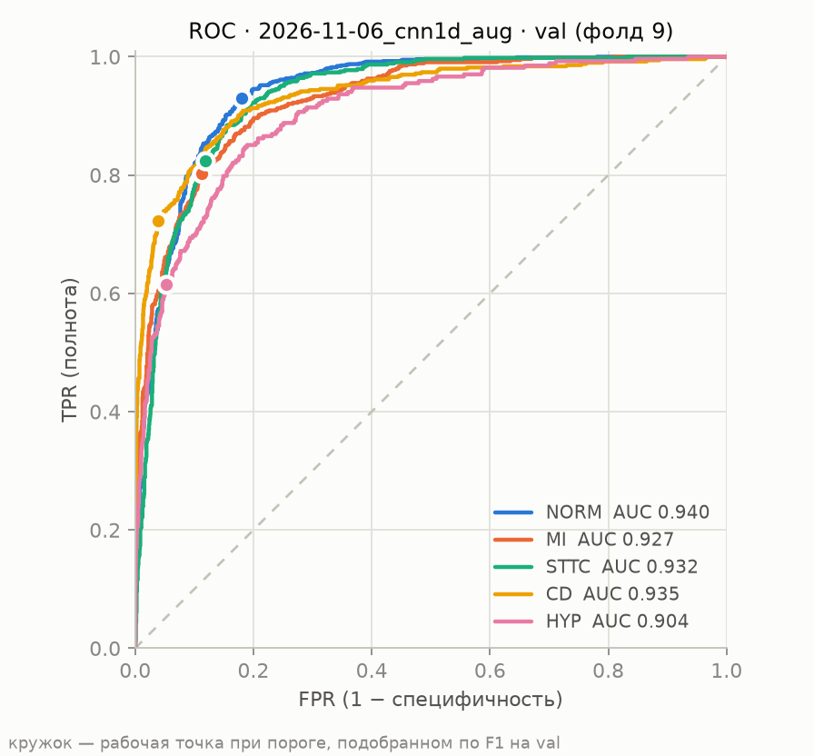
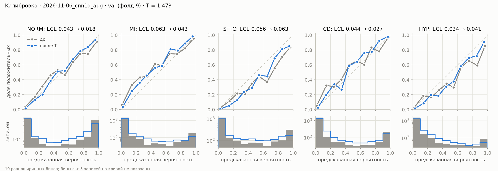

<div align="center">

# 🫀 ECG classification on PTB-XL

**A neural network that reads a 12-lead ECG and says which of five diagnostic groups it resembles, evaluated with a strict, leak-free protocol.**

[English](README.md) · [Русский](README.ru.md)

[About](#about) · [Screenshots](#screenshots) · [Results](#results) · [Lead experiment](#lead-experiment) · [Calibration](#calibration) · [Local app](#local-app) · [Limitations](#limitations) · [Run it](#run-it)

</div>

> **Research prototype, not a medical device.** It is not meant for diagnosis or any clinical decision.

---

## About

An **ECG** records the electrical activity of the heart. A standard one has **12 leads** (12 "views" of the heart from different angles), and a doctor reads it for signs of infarction, conduction block, enlarged heart muscle and so on.

This project trains a model on **PTB-XL**, a large public ECG dataset, to read a 10-second, 12-lead recording and output a probability for each of **five diagnostic superclasses**:

| Class | Meaning |
|---|---|
| NORM | normal ECG |
| MI | myocardial infarction |
| STTC | ST–T changes |
| CD | conduction disturbance |
| HYP | hypertrophy |

The problem is **multi-label**: one record can belong to several classes at once, so the five probabilities do not have to sum to 1.

The goal is not a product but an **honest research pipeline**, built as a portfolio piece:

- **Strict data protocol.** Train on folds 1–8, tune everything on fold 9, touch the test fold 10 **exactly once** at the very end. Normalisation statistics come from train only.
- **Two kinds of models.** A LightGBM baseline on hand-made features versus 1D convolutional networks on the raw signal.
- **Uncertainty, not just point values.** 95% confidence intervals on test (bootstrap over patients), paired comparison between models.
- **Calibration.** Are the predicted probabilities trustworthy? A temperature fitted on val, ECE and Brier score.
- **A look inside the model.** Integrated Gradients maps, with controls that show what they do and do not prove.
- **A local app** where you can drop in your own ECG file, get a signal-quality check, probabilities, attribution maps and a PDF report.

### Headline result (test, fold 10, evaluated once)

| | 1D-CNN + augmentations | LightGBM on features |
|---|---|---|
| macro AUROC | **0.922** [0.914, 0.929] | 0.880 [0.871, 0.889] |
| macro PR-AUC | **0.811** [0.794, 0.827] | 0.739 [0.719, 0.757] |
| macro F1 (thresholds from val) | **0.743** [0.727, 0.757] | 0.666 [0.649, 0.681] |

The CNN wins on all three, and the confidence intervals of the differences exclude zero. On the rarest class, **HYP, there is no reliable advantage** (ΔAUROC +0.013, 95% CI [−0.001, 0.028]). Full tables are in [Results](#results).

### How the pipeline works



---

## Screenshots

The local app (`app/app.py`) runs on your computer and sends nothing anywhere. The interface is in Russian. The example below is a built-in record from the validation fold with the PTB-XL label **CD**; the model puts CD at 0.919 and STTC at 0.595, both above their thresholds.

<div align="center">



<sub>Start screen: upload a WFDB, EDF or CSV recording, or pick a built-in example.</sub>

<br><br>



<sub>Calibrated probabilities with the thresholds tuned on val, a signal-quality verdict, and a reminder that classes are not mutually exclusive.</sub>

<br><br>



<sub>All 12 leads on a standard ECG grid.</sub>

<br><br>



<sub>Integrated Gradients for the selected class: red raises the model's confidence in the class, blue lowers it. In this example lead V1 carries the largest share (21%). It is an attribution of the model's answer, <b>not an explanation of the cause</b>.</sub>

<br><br>



<sub>First page of the generated PDF report (5 pages in total: summary, signal quality, 12 leads, attribution maps, model version and limitations).</sub>

</div>

There is also a static page with five precomputed validation examples (no weights, no raw signals): **[saltyrril.github.io/ekg_project/demo](https://saltyrril.github.io/ekg_project/demo/)**. The examples there are chosen so that the model is right, so the page shows no model errors.

---

## Data and split

- **PTB-XL**, the 100 Hz version, 12 leads.
- Labels: `scp_codes` from `ptbxl_database.csv`, mapped to a superclass via `diagnostic_class` in `scp_statements.csv`. All codes count regardless of likelihood (`min_likelihood: 0`, as in the PTB-XL benchmark).
- Records without a superclass are dropped, and their number is logged: **train 334, val 37, test 40**.
- Split by the ready-made `strat_fold`. Any other split raises `ValueError` in `src/data.py`.

| Set | Folds | Used for | Records |
|---|---|---|---|
| train | 1–8 | training, normalisation statistics | TODO (not stated in `results/experiments.csv`, `summary.md` or `final/metrics.json`) |
| val | 9 | model choice, early stopping, temperature T, thresholds | TODO (same) |
| test | 10 | final evaluation only, once | 2158 (1877 patients) |

- Normalisation: z-score per lead, mean/std from train only.
- Class prevalence on test: NORM 0.446, MI 0.255, STTC 0.241, CD 0.230, HYP 0.121.
- The data cache was checked against the PTB-XL CSV (`scripts/verify_cache.py`, report `results/final/cache_check.json`) after the final run, and the check passed: folds, record set, labels, `patient_id` and normalisation statistics match, and no patient appears in two sets.

## Methods

**Baseline: LightGBM** (`src/features.py`, `src/baseline.py`, `configs/baseline.yaml`). 12 statistics per lead over 12 leads, plus rhythm and intervals (heart rate, RR, PR, QRS, QT, QTc) from neurokit2: 156 features in total (variant `stats_plus_neurokit`). One binary LightGBM per class (one-vs-rest), early stopping on val AUROC. At 100 Hz the intervals are rough and biased, so read them as relative features, not clinical values.

**Neural networks** (`src/models.py`, `src/train.py`, `configs/*.yaml`). Models output logits; the sigmoid is applied outside.
- `cnn1d`: 5 Conv1d–BatchNorm–ReLU–MaxPool blocks (channels 32/64/128/256/256, kernel 7), head = mean and max over time, Dropout 0.3, Linear. 766,533 parameters.
- `resnet1d`: 1D ResNet-18 (stem with kernel 15 and stride 2, 4 stages of 2 blocks), same head. 2,192,197 parameters.
- Training: BCEWithLogitsLoss, AdamW, 1 warm-up epoch then cosine decay, mixed precision (float16), batch 128, early stopping on val macro AUROC, seed 42. `pos_weight` is off because it inflates probabilities and hurts calibration. The output bias is initialised to the logit of the class share in train.
- Augmentations (`src/augment.py`, train only): time shift ±0.5 s, amplitude scaling ×U(0.8, 1.2), baseline wander, Gaussian noise, each with p = 0.5. The `*_aug` variants differ from the plain ones only by these.

**Post-processing and evaluation** (`src/evaluate.py`). One shared temperature T for all classes (fitted by NLL on val), then per-class thresholds that maximise F1 on the calibrated val probabilities. For `cnn1d_aug`, T = 1.473. Confidence intervals on test come from a percentile paired bootstrap over `patient_id`, 2000 replicates.

All parameters live in YAML configs, and every run writes its config, metrics and time to `results/`.

## Results

### Validation (fold 9)
Source: `results/experiments.csv`, `results/summary.md`. One seed (42) per run, no confidence intervals. **This is not the final evaluation**: model, epoch, T and thresholds were chosen on val, so the numbers are slightly optimistic.

| Model | Aug. | Parameters | Time, s | macro AUROC | macro PR-AUC |
|---|---|---|---|---|---|
| LightGBM (baseline) | — | — | 30.5 | 0.8939 | 0.7505 |
| cnn1d | no | 766,533 | 62.9 | 0.9263 | 0.8098 |
| **cnn1d_aug** | yes | 766,533 | 138.0 | **0.9277** | **0.8130** |
| resnet1d | no | 2,192,197 | 130.1 | 0.9231 | 0.8037 |
| resnet1d_aug | yes | 2,192,197 | 266.8 | 0.9271 | 0.8109 |

AUROC per class (val):

| Model | NORM | MI | STTC | CD | HYP |
|---|---|---|---|---|---|
| LightGBM | 0.9172 | 0.8634 | 0.8990 | 0.8831 | 0.9066 |
| cnn1d | 0.9415 | 0.9213 | 0.9304 | 0.9298 | 0.9085 |
| cnn1d_aug | 0.9405 | 0.9272 | 0.9316 | 0.9351 | 0.9041 |
| resnet1d | 0.9435 | 0.9110 | 0.9323 | 0.9292 | 0.8996 |
| resnet1d_aug | 0.9462 | 0.9300 | 0.9312 | 0.9281 | 0.8999 |

The networks differ from each other by 0.005 macro AUROC or less on val; with one seed that cannot be told apart from noise. For `cnn1d_aug` on val: macro F1 with thresholds 0.741 (cross-fit), macro ECE 0.048 → 0.038 after T. For the other models, macro F1 and ECE on val: TODO (not in the listed sources; see `results/*/eval_val.json`).

`cnn1d_aug` was chosen: best val macro AUROC and PR-AUC with almost three times fewer parameters than the ResNet.

<div align="center">

<br><sub>ROC curves of <code>cnn1d_aug</code> on val (fold 9). Dots mark the operating points at the thresholds tuned for F1.</sub>
</div>

### Final evaluation (test, fold 10, once)
Source: `results/final/metrics.json` (readable version: `results/final/table.md`). The `cnn1d_aug` model with T and thresholds fitted on val. The LightGBM weights were not saved, so it was retrained with the same code and seed (reproduction was verified before reading test: val macro AUROC and `best_iteration` matched exactly); its T = 1.068 and thresholds were fitted on val by the same procedure. Brackets give the 95% CI; the difference is a paired bootstrap on the same replicates.

| Metric | 1D-CNN + augmentations | LightGBM on features | Difference |
|---|---|---|---|
| macro AUROC | 0.922 [0.914, 0.929] | 0.880 [0.871, 0.889] | +0.042 [0.035, 0.049] |
| macro PR-AUC | 0.811 [0.794, 0.827] | 0.739 [0.719, 0.757] | +0.073 [0.058, 0.087] |
| macro F1 (thresholds from val) | 0.743 [0.727, 0.757] | 0.666 [0.649, 0.681] | +0.076 [0.063, 0.091] |
| micro F1 (thresholds from val) | 0.775 [0.762, 0.788] | 0.695 [0.680, 0.709] | +0.080 [0.068, 0.093] |
| macro recall | 0.765 [0.746, 0.782] | 0.713 [0.691, 0.733] | +0.051 [0.034, 0.068] |
| macro specificity | 0.898 [0.892, 0.904] | 0.860 [0.852, 0.867] | +0.038 [0.032, 0.046] |

Per class (test):

| Class | Share | AUROC CNN | AUROC LightGBM | ΔAUROC | PR-AUC CNN | PR-AUC LightGBM |
|---|---|---|---|---|---|---|
| NORM | 0.446 | 0.941 [0.931, 0.950] | 0.904 [0.890, 0.916] | +0.037 [0.028, 0.047] | 0.919 [0.904, 0.934] | 0.874 [0.851, 0.893] |
| MI | 0.255 | 0.923 [0.910, 0.934] | 0.848 [0.828, 0.865] | +0.075 [0.060, 0.092] | 0.835 [0.806, 0.860] | 0.683 [0.638, 0.722] |
| STTC | 0.241 | 0.934 [0.922, 0.945] | 0.898 [0.882, 0.912] | +0.036 [0.026, 0.048] | 0.819 [0.783, 0.852] | 0.734 [0.693, 0.771] |
| CD | 0.230 | 0.913 [0.894, 0.929] | 0.866 [0.844, 0.887] | +0.047 [0.031, 0.062] | 0.829 [0.796, 0.859] | 0.755 [0.716, 0.790] |
| HYP | 0.121 | 0.899 [0.879, 0.917] | 0.886 [0.862, 0.907] | +0.013 [−0.001, 0.028] | 0.654 [0.595, 0.708] | 0.649 [0.587, 0.704] |

Takeaways:
- The CNN beats LightGBM on macro AUROC, PR-AUC and F1: the 95% CIs of the differences exclude zero.
- On HYP (the rarest class) there is no advantage: the CI of the AUROC difference includes zero, and PR-AUC is practically the same.
- Macro AUROC on test (0.922) is slightly below val (0.928), as expected when selection is done on val.

## Lead experiment
Question: how many leads does the model need? The same `cnn1d_aug` (the configs `configs/cnn1d_aug_leads_*.yaml` differ only in the set of leads; everything else is identical to `cnn1d_aug`) was trained on subsets of leads. Source: `results/experiments.csv`, `results/summary.md`. **Val (fold 9) only, one seed**; test was not used.

| Leads | Count | macro AUROC | NORM | MI | STTC | CD | HYP |
|---|---|---|---|---|---|---|---|
| I | 1 | 0.8442 | 0.8882 | 0.8005 | 0.8842 | 0.8357 | 0.8123 |
| I, II | 2 | 0.8992 | 0.9310 | 0.8979 | 0.9116 | 0.9106 | 0.8449 |
| I, II, III, AVR, AVL, AVF | 6 | 0.9014 | 0.9318 | 0.9016 | 0.9124 | 0.9156 | 0.8454 |
| all 12 | 12 | **0.9277** | 0.9405 | 0.9272 | 0.9316 | 0.9351 | 0.9041 |

- The control run `leads_all12` reproduced `cnn1d_aug` on AUROC and PR-AUC (0.9277 and 0.813).
- Going from one lead to two gives +0.055 macro AUROC, and from six to twelve +0.026. The six limb leads are practically no better than the pair I, II (+0.002, within the noise of a single seed).
- HYP suffers most from missing leads: 0.9041 with 12 leads against 0.8454 with 6. The explanation (chest leads carry information about hypertrophy) is a hypothesis; this experiment did not test it.
- The single-lead model (0.8442) is already below LightGBM on 12 leads (0.8939, val), so for this feature set and architecture one lead is clearly worse. This says nothing about the suitability of wearables.

## Calibration
Source: `results/final/metrics.json` (test). Calibration is a single shared temperature T fitted on val: T = 1.473 for the CNN and T = 1.068 for LightGBM. ECE uses 10 equal-width bins (`configs/evaluate.yaml`); lower is better.

| Metric (test) | CNN, no T | CNN, with T | LightGBM, no T | LightGBM, with T |
|---|---|---|---|---|
| macro ECE | 0.051 [0.047, 0.059] | 0.038 [0.036, 0.046] | 0.028 [0.027, 0.039] | 0.026 [0.025, 0.036] |
| macro Brier | — | 0.087 [0.083, 0.092] | — | 0.107 [0.103, 0.112] |
| macro NLL | — | 0.286 [0.273, 0.300] | — | 0.343 [0.329, 0.357] |

ECE per class after T (test): CNN — NORM 0.018, MI 0.052, STTC 0.058, CD 0.020, HYP 0.044; LightGBM — NORM 0.040, MI 0.025, STTC 0.024, CD 0.021, HYP 0.018.

- Temperature lowers the CNN's macro ECE (0.051 → 0.038); on val the direction is the same (0.048 → 0.038, cross-fit).
- On Brier and NLL the CNN beats LightGBM (Brier difference −0.020 [−0.023, −0.017]).
- On binned ECE the point value is lower for LightGBM (0.026 vs 0.038), but no reliable conclusion can be drawn: bootstrap CIs of a binned ECE are biased upward (sampling noise adds to the calibration error) and may not cover the point value. Brier is the safer way to compare calibration.
- Per-class calibration (`temperature: per_class`): TODO, not done.

<div align="center">

<br><sub>Reliability diagrams of <code>cnn1d_aug</code> on val (fold 9) before and after temperature scaling.</sub>
</div>

## Error analysis
What is available on test (from `results/final/metrics.json`; thresholds fitted on val):

| Class | Precision CNN | Recall CNN | Specificity CNN | Precision LGBM | Recall LGBM | Specificity LGBM |
|---|---|---|---|---|---|---|
| NORM | 0.800 | 0.930 | 0.813 | 0.779 | 0.836 | 0.809 |
| MI | 0.706 | 0.776 | 0.889 | 0.549 | 0.702 | 0.803 |
| STTC | 0.697 | 0.818 | 0.887 | 0.630 | 0.766 | 0.857 |
| CD | 0.820 | 0.688 | 0.955 | 0.689 | 0.611 | 0.918 |
| HYP | 0.615 | 0.611 | 0.947 | 0.506 | 0.653 | 0.912 |

- The CNN's weakest class by F1 is HYP (0.613 [0.562, 0.661]), also the rarest; for MI, STTC and CD the F1 is in the range 0.739–0.753.
- For CD the CNN has high precision (0.820) and low recall (0.688): at the threshold chosen on val, part of the CD cases is missed.
- HYP is the only class where LightGBM's recall is higher (0.653 vs 0.611), but the CI of the difference (−0.091…0.004) includes zero.
- For NORM the recall is high (0.930) while the specificity is 0.813: the model more often takes pathology for normal than the other way round. This is a conclusion from these numbers only; without looking at individual records no cause can be named.

A detailed error analysis (confusion matrices, slices by sex and age, confident errors): **TODO**. Those numbers are not in `results/experiments.csv`, `results/summary.md` or `results/final/metrics.json`, and I did not copy them into the README without a source. The code exists (`src/error_analysis.py`, `configs/error_analysis.yaml`, `notebooks/02_error_analysis.ipynb`); it reads val only, and the val figures are in `results/figures/<run>/` (ROC, PR, confusion, calibration). A breakdown of MI and STTC by subtype was not done.

**Attribution maps** (Integrated Gradients, `src/explain.py`, val only): the model is sensitive to QRS, but part of this effect is explained by signal amplitude (checked with controls: a randomly initialised model and an |x| map); a conclusion about the ST–T segment is not supported. This illustrates the model's sensitivity, not what a physician looks at. Numbers and caveats are in `docs/decisions.md`; the pictures are in `results/figures/2026-11-06_cnn1d_aug/explain/`.

## Local app

`python app/app.py`, then open http://127.0.0.1:7860 (needs a built `app/model`, see [Run it](#run-it)). It runs entirely on your computer and sends nothing anywhere. It accepts:

| Format | What to upload | Notes |
|---|---|---|
| WFDB | `<name>.hea` + `<name>.dat` | units and sampling rate come from the header |
| EDF / EDF+C | one `.edf` | channels by name (`ECG I`, `aVR`, `V1` …), units from the header; EDF+D is not supported |
| CSV / TXT | one file: columns I, II, III, aVR, aVL, aVF, V1–V6, one row per sample | a header is preferred, otherwise exactly 12 columns in that order; the sampling rate comes from a time column or is entered by hand; units (mV/µV/V) are chosen in the UI; `;`, tabs and decimal commas are fine |

A recording must be at least 10 s long (the first 10 s are used) and sampled at 100 Hz or more; higher rates are resampled to 100 Hz (250, 256, 360, 500, 1000 and so on). All 12 leads are required. PDFs, photos and paper ECGs are not supported.

**Signal-quality check** (`app/quality.py`, scipy heuristics, no training) gives a verdict "good / warnings / poor" and lists the issues: flat leads and dropouts, high-frequency noise, baseline wander, no QRS complexes (noise instead of an ECG), implausible amplitude and heart rate (a sign of wrong units), Einthoven inconsistency between leads (swapped electrodes or order), duplicated leads. With a "poor" verdict the model's answer is marked "unreliable". The thresholds were checked on val (fold 9, test not read): `python scripts/check_quality.py` → `results/2026-11-06_quality_check/`. From that run:
- clean val records are rated "good" in 88.9% of cases (warnings in 11.0%, "poor" in about 0%);
- a flat lead, a signal dropout, wrong units (×1000, ×0.001) and noise instead of an ECG are caught in 100% of the synthetic cases, and swapped leads are flagged as a warning in 100%;
- limitations: strong noise or drift gets "poor" only when ≥6 leads are affected (at a noise level of 0.2 of the range, which drops the model's macro AUROC by 0.11, that is only 13% of records; the rest get "warnings");
- the PTB-XL `static_noise` flag is not reproduced (4% vs 12% for the rest), `baseline_drift` partly (34% vs 8%);
- the thresholds were tuned on PTB-XL and may give extra warnings on other devices.

**PDF report** (a button in the app, `app/report.py`, matplotlib only): summary (record, signal quality, class probabilities and thresholds), 12 leads, attribution maps for classes above threshold (or for the most probable one), model version (run, commit, sha256 of the weights, T, thresholds), method and limitations. A "not a medical document" disclaimer is on every page.

Tests for the readers and the quality check: `python -m unittest discover -s tests`.

## Limitations
- A research prototype, not a medical device: not for diagnosis or clinical decisions.
- Val metrics (fold 9) are optimistic: model, epoch, T and thresholds were chosen on them. The unbiased estimate is test only.
- One seed (42) per model, so the spread between runs is not estimated; differences of ≤0.005 AUROC between variants on val are within noise. The lead comparison is also one seed and val only.
- ECE is not reliably estimated (biased bootstrap CIs), so there is no conclusion about an advantage in calibration.
- On HYP the CNN has no advantage over LightGBM.
- The test baseline was obtained by retraining (the weights were not saved); its T and thresholds were fitted on val by the same procedure as the CNN's. This decision was made during implementation, after the plan had been agreed, and is described in `docs/decisions.md`.
- The final run was made on a "dirty" git tree (`05a36b3` plus uncommitted files). The version of `src/final_eval.py` used for that run is not saved in git (sha1 `a4c0d22f2b33`), so exact reproduction from git is not guaranteed; the numbers in `results/final/metrics.json` are the result of that single run. A re-run is blocked in the code.
- `git_dirty = True` in `results/experiments.csv`: the network code was not committed at the time of the val runs.
- The val summary has duplicates: `2026-11-05_resnet1d_234721` repeats `2026-11-05_resnet1d`, and `leads_all12` repeats `cnn1d_aug` (these are reproducibility checks, not separate experiments).
- 100 Hz: interval detection (PR, QRS, QT) is rough; the 500 Hz version was not tried.
- PTB-XL labels come from automatic and manual annotation with varying confidence (likelihood); all codes are used here with no threshold. External validation on other datasets: TODO, not done.
- Comparison with the benchmark authors' numbers: TODO (the permitted sources contain no benchmark numbers). The protocols differ, so a direct comparison is only fair with the same folds and metric.

## Run it

Install (Windows, PowerShell):
```powershell
python -m venv .venv
.venv\Scripts\Activate.ps1
pip install torch torchvision --index-url https://download.pytorch.org/whl/cu126
pip install -r requirements.txt
python scripts/check_env.py   # interpreter in .venv, versions from requirements.txt, torch + CUDA
python scripts/check_cuda.py  # detailed GPU check
```
Data: put the unpacked PTB-XL archive (`ptbxl_database.csv`, `scp_statements.csv`, `records100/`) into `data/ptb-xl` (the path is set in `configs/data.yaml`). The data is not stored in git.

Pipeline:
```powershell
python -m src.data --config configs/data.yaml                    # signal cache, normalisation stats (train only), log of excluded records
python -m src.baseline --config configs/baseline.yaml            # LightGBM
python -m src.train --config configs/cnn1d_aug.yaml              # a network (also cnn1d, resnet1d, resnet1d_aug, cnn1d_aug_leads_*)
python -m src.evaluate --run results/2026-11-06_cnn1d_aug        # T, thresholds, F1, calibration and plots on val
python -m src.explain --config configs/explain.yaml              # attribution maps on val
python scripts/summarize_results.py                              # results/experiments.csv and results/summary.md
```
The final test evaluation was run once (`results/final/`). `python -m src.final_eval` stops if `results/final/metrics.json` already exists; `--dry-run` checks the pipeline on val and does not read test. Do not tune hyperparameters, T, thresholds or the model on test numbers.

Local app and the static demo both need a local `app/model` (not in git):
```powershell
pip install gradio==6.31.0                                     # the script imports app/app.py
python scripts/export_app_bundle.py --config configs/app.yaml  # app/model; checks agreement with val_probs.npy, does not read test
python app/app.py                                              # the app at http://127.0.0.1:7860
python scripts/export_static_demo.py --config configs/static_demo.yaml   # rebuild docs/demo
```
Everything was trained on an RTX 3050 Laptop (4 GB): mixed precision, batch 128.

### Repository layout
```
src/        data, features, baseline, models, train, evaluate, explain, final_eval, error_analysis
app/        local Gradio app: app.py, inference.py, readers.py, quality.py, report.py
configs/    YAML config for every experiment
scripts/    environment checks, result summary, cache verification, bundle and demo export
results/    metrics, figures, experiments.csv, summary.md, final/ (test, evaluated once)
docs/       decisions.md (decision log), demo/ (static page), img/ (screenshots)
tests/      unit tests for the readers and the quality check
notebooks/  EDA and error analysis (analysis only, code lives in src/)
```

## References
- PTB-XL dataset (PhysioNet): https://physionet.org/content/ptb-xl/
- Wagner P. et al. *PTB-XL, a large publicly available electrocardiography dataset.* Scientific Data, 2020. https://doi.org/10.1038/s41597-020-0495-6
- The authors' benchmark: Strodthoff N. et al. *Deep Learning for ECG Analysis: Benchmarks and Insights from PTB-XL.* IEEE Journal of Biomedical and Health Informatics, 2021. https://doi.org/10.1109/JBHI.2020.3022989
- Benchmark code: https://github.com/helme/ecg_ptbxl_benchmarking
- Internal decision log: [`docs/decisions.md`](docs/decisions.md)
